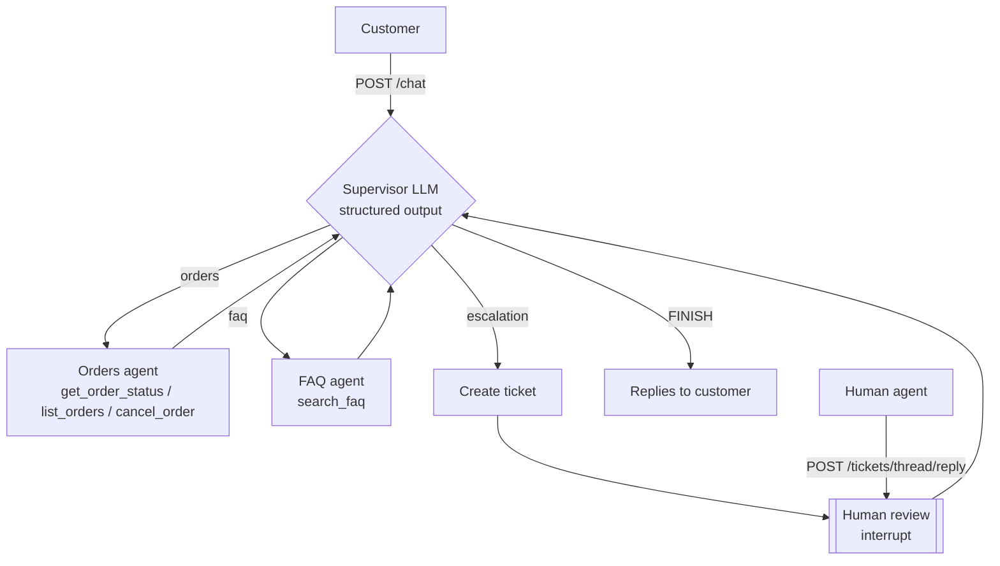

# Multi-Agent Customer Support System

[](https://github.com/sakshi1801/multi-agent-customer-support/actions/workflows/ci.yml)

A supervisor-based multi-agent system built with **LangGraph**, served via **FastAPI**. A supervisor LLM routes each customer message to specialist agents (orders, FAQ, escalation). Escalations pause the graph and wait for a **human agent** (human-in-the-loop), then resume.

**Stack:** Python · LangGraph · LangChain · FastAPI · Pydantic · SQLite · Groq / OpenRouter / Ollama / OpenAI / Azure OpenAI · LangSmith · pytest · Ruff · Docker · GitHub Actions

## Architecture



## What this demonstrates

- **Supervisor pattern**: the router returns a validated Pydantic `Route` (structured output), not free text.
- **Tool calling**: specialists use real tools against a SQLite database and a policy FAQ.
- **Multi-agent in one turn**: "Status of ORD-1005 and what's your return policy?" visits Orders, then FAQ.
- **Human-in-the-loop**: `interrupt()` + a checkpointer pause the conversation; `Command(resume=...)` continues it.
- **Safety**: hop limit prevents routing loops; only `processing` orders can be cancelled; the ticket is created once (creation and `interrupt()` live in separate nodes because a node re-runs on resume).
- **Testable**: 29 tests run with a deterministic fake LLM, so CI needs no API key.

## Quick start

```bash
python -m venv .venv && source .venv/bin/activate      # Windows: .venv\Scripts\activate
pip install -r requirements.txt
cp .env.example .env                                   # add ONE key: Groq or OpenRouter (free), OpenAI or Azure
uvicorn app.main:app --reload
```

Open http://localhost:8000/docs for the interactive API.

### Try it

```bash
# 1. Order lookup
curl -s localhost:8000/chat -H 'content-type: application/json' \
  -d '{"message":"Where is ORD-1001?"}'

# 2. Two specialists in one turn
curl -s localhost:8000/chat -H 'content-type: application/json' \
  -d '{"message":"Status of ORD-1005, and what is your return policy?"}'

# 3. Escalation -> returns status "waiting_for_human" and a thread_id
curl -s localhost:8000/chat -H 'content-type: application/json' \
  -d '{"message":"This is unacceptable, I want a human","customer_email":"asha@example.com"}'

# 4. See open tickets, then answer as the human agent
curl -s localhost:8000/tickets
curl -s localhost:8000/tickets/<thread_id>/reply -H 'content-type: application/json' \
  -d '{"reply":"Sorry about that! We are sending a replacement."}'
```

Demo data: orders `ORD-1001` to `ORD-1005` for `asha@`, `ravi@`, `meera@example.com`.

## Tests, Docker, tracing

```bash
pip install -r requirements-dev.txt         # adds pytest and ruff
pytest -q                                   # 29 tests, no API key needed
ruff check . && ruff format --check .       # lint + formatting (also run in CI)
docker build -t support-agents . && docker run --env-file .env -p 8000:8000 support-agents
```

Set `LANGSMITH_TRACING=true` and `LANGSMITH_API_KEY` in `.env` to see every supervisor decision and tool call in LangSmith.

## Project layout

```
app/config.py   LLM setup: any OpenAI-compatible provider (Groq, OpenRouter, Ollama, OpenAI, Azure)
app/db.py       SQLite schema + demo data
app/tools.py    agent tools
app/graph.py    supervisor + specialists + human-in-the-loop
app/main.py     FastAPI endpoints and schemas
tests/          fake-LLM tests for tools, routing, escalation, API
docs/           development plan
```

## Evaluation

> Fill in after you run it against a real model (see `tests/` for the scenarios):
> routing accuracy on N hand-written test messages: **__ / __**, with a LangSmith trace screenshot.

## Known limitations / next steps

See [docs/DEVELOPMENT_PLAN.md](docs/DEVELOPMENT_PLAN.md) for the full roadmap.


- `MemorySaver` is in-memory: use a Postgres or SQLite checkpointer for production.
- The FAQ search is keyword-based; swap in embeddings + pgvector for larger knowledge bases.
- No authentication on the human-agent endpoints (demo only).
