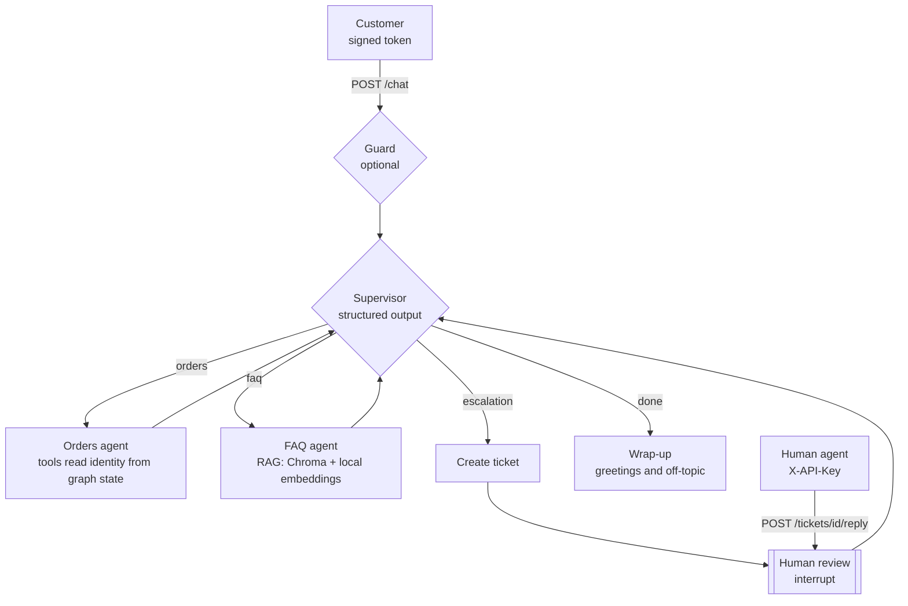

# Multi-Agent Customer Support System

[](https://github.com/sakshi1801/multi-agent-customer-support/actions/workflows/ci.yml)

A customer-support assistant built with **LangGraph** and **FastAPI**. A supervisor reads each message and
sends it to specialist agents: **Orders** (tool calling against a database), **FAQ** (retrieval-augmented
answers that cite their source) and **Escalation**, which pauses the conversation for a **human agent** and
resumes it when they reply. It runs entirely on **free tiers** (Groq or OpenRouter) or a local model (Ollama).

**Stack:** Python · LangGraph · LangChain · FastAPI · Pydantic · SQLite · Chroma · FastEmbed · Groq / OpenRouter / Ollama / OpenAI / Azure OpenAI · pytest · Ruff · Docker · GitHub Actions

## Architecture



Two supervisor designs are implemented and compared in the evaluation: **loop** (ask the model who goes next
after every specialist) and **plan** (ask once for every specialist the message needs).

## What this demonstrates

- **Supervisor pattern** built as a LangChain Runnable chain: `prompt | llm.with_structured_output(Route or Plan)`.
- **Tool calling with server-side identity**: order tools read *who the customer is* from the graph state (`ToolRuntime`), set from a signed login token. The model never sees or chooses it, so it cannot be talked into reading another customer's orders.
- **RAG over a 41-section knowledge base**: document loader, heading-based splitter, local ONNX embeddings, Chroma vector store, retrievers compared on a labelled question set; answers cite `[Topic > Section]`.
- **Human-in-the-loop**: `interrupt()` + a SQLite checkpointer pause the conversation (it survives a server restart); a human replies by ticket ID and `Command(resume=...)` continues it.
- **Resilience**: retries, provider fallbacks (`.with_fallbacks()`), and graceful degradation: if routing fails the customer is handed to a human instead of getting a 500.
- **Measured, not assumed**: a 132-case labelled evaluation with confidence intervals, an end-to-end suite that checks facts, data leaks and database state, and a retrieval benchmark.
- **Free to run**: Groq free tier, OpenRouter `:free` models, or a local Ollama model; local embeddings.

## Results

Full tables, methodology and the raw files: **[docs/EVALUATION.md](docs/EVALUATION.md)**.

<!-- RESULTS-START -->
All figures are on free tiers or locally, on hand-labelled cases, with 95% confidence intervals in the full report.

| Measure | Result |
|---|---|
| **Routing accuracy**, 132 labelled messages (gpt-oss-120b, planner supervisor) | **92.4% (122/132, 95% CI 87-96%)**, against 87.1% (115/132, 95% CI 80-92%) for the original loop supervisor and 72.0% (95/132, 95% CI 64-79%) for keyword rules |
| **Escalation recall** (angry or legal messages reach a human) | 100.0% (25/25, 95% CI 87-100%); precision 89.3% (25/28, 95% CI 73-96%) |
| **Cost of a decision**, planner against loop | model calls per message 1.78 -> 1.0 (-44%), tokens 950 -> 476 (-50%), median latency 1.44 s -> 0.75 s |
| **Fully local, offline** (4B model on a laptop GPU via Ollama) | routing 84.8% (112/132, 95% CI 78-90%) with the planner (53.0% (70/132, 95% CI 45-61%) with the loop); end to end 68.8% (22/32, 95% CI 51-82%); attacks that leaked nothing: 100.0% (9/9, 95% CI 70-100%) |
| **FAQ retrieval** (top-3 contains the right section, 41 questions) | vector search 92.7% against 53.7% for the prototype's keyword search; BM25, hybrid fusion and a reranker were measured and did not beat vector search |
| **Tests** | 120+ deterministic tests with a fake model (no API key), run in CI together with a Docker image build and container smoke test |
<!-- RESULTS-END -->

## Quick start

```bash
python -m venv .venv && source .venv/bin/activate      # Windows: .venv\Scripts\activate
pip install -r requirements.txt
cp .env.example .env     # add ONE model key (Groq / OpenRouter are free) plus TOKEN_SECRET and AGENT_API_KEY
uvicorn app.main:app --reload
```

Open http://localhost:8000/ for the demo page (customer chat and human-agent console), or
http://localhost:8000/docs for the API. The first start downloads a small embedding model (about 130 MB, once).

### Try it from the command line

Demo customers `asha@example.com`, `ravi@example.com` and `meera@example.com` all use the password `demo1234` (fake data only).

```bash
# Log in -> a signed token (identity comes from this token, never from the message)
TOKEN=$(curl -s localhost:8000/auth/login -H 'content-type: application/json' \
  -d '{"email":"asha@example.com","password":"demo1234"}' | python -c "import sys,json; print(json.load(sys.stdin)['access_token'])")

# Two specialists in one message
curl -s localhost:8000/chat -H "authorization: Bearer $TOKEN" -H 'content-type: application/json' \
  -d '{"message":"Status of ORD-1002, and how long do refunds take?"}'

# Escalation -> status "waiting_for_human" and a ticket_id; a human agent then replies
curl -s localhost:8000/chat -H "authorization: Bearer $TOKEN" -H 'content-type: application/json' \
  -d '{"message":"This is unacceptable, I want a human"}'
curl -s localhost:8000/tickets -H "x-api-key: $AGENT_API_KEY"
curl -s localhost:8000/tickets/1/reply -H "x-api-key: $AGENT_API_KEY" -H 'content-type: application/json' \
  -d '{"reply":"Sorry about that! We are sending a replacement."}'
```

## Configuration

| Variable | Meaning |
|---|---|
| `GROQ_API_KEY`, `GROQ_MODEL` | free hosted models (`qwen/qwen3.8-27b`, `openai/gpt-oss-120b`, ...) |
| `OPENROUTER_API_KEY`, `OPENROUTER_MODEL` | free models with a `:free` suffix |
| `LLM_BASE_URL`, `LLM_MODEL` | any OpenAI-compatible server, e.g. local Ollama (`http://localhost:11434/v1`) |
| `LLM_PROVIDER`, `LLM_FALLBACKS` | pick a provider explicitly; providers to try when the main one fails |
| `SUPERVISOR_MODE` | `plan` (one routing call per message) or `loop` |
| `TOKEN_SECRET`, `AGENT_API_KEY` | signs login tokens; password of the human-agent endpoints |
| `GUARD=promptguard` | optional Llama Prompt Guard layer (free on Groq) |
| `LANGSMITH_TRACING`, `LANGSMITH_API_KEY` | optional tracing of every supervisor decision and tool call |

## Tests and evaluation

```bash
pip install -r requirements-dev.txt
pytest -q                                   # 120+ tests, no API key and no model download needed
ruff check . && ruff format --check .       # lint + formatting (also run in CI)
python -m evals.run_eval routing --router keyword                    # offline floor
python -m evals.run_eval routing --provider groq --model qwen/qwen3.8-27b --supervisor plan --label planner
python -m evals.retrieval_eval                                       # retrieval comparison, local and free
python -m evals.summary                                              # rebuild docs/EVALUATION.md
```

CI also builds the Docker image and smoke-tests the running container. Deployment on free hosting: [docs/DEPLOY.md](docs/DEPLOY.md).

## Security model

| Threat | Defence |
|---|---|
| Customer reads or cancels another customer's order, including through prompt injection | The customer comes from the signed token and is injected into the tools; every SQL query filters on it; the model-visible tool schema has no identity argument. Another customer's order looks identical to a missing one. |
| Blunt prompt injection | Optional Llama Prompt Guard layer, measured: it is an extra layer, not the defence (see the evaluation) |
| Forged, expired or tampered tokens | HMAC-signed tokens with expiry, constant-time comparison |
| Reading or continuing someone else's conversation | Threads are bound to their owner; unknown and foreign threads look the same |
| Anyone calling the human-agent endpoints | `X-API-Key` required; the endpoints stay closed if no key is configured |
| Model outage | Retries, provider fallbacks, then escalation to a human, then a clean 503 without internals |
| Model output rendered in the browser | The demo page inserts model text with `textContent` only, never as HTML |

## Project layout

```
app/config.py     providers (any OpenAI-compatible), fallbacks, retrieval settings
app/auth.py       password hashing, signed tokens, agent API key
app/orders.py     order operations, always scoped to one customer
app/tools.py      agent tools (thin wrappers that read the customer from graph state)
app/rag.py        loader, splitter, embeddings, Chroma, retrievers
app/graph.py      supervisor (loop and plan), specialists, human-in-the-loop
app/guard.py      optional prompt-injection guard
app/main.py       FastAPI endpoints, demo page route
app/static/       the demo page (one self-contained HTML file)
data/kb/          the knowledge base (Markdown)
evals/            dataset, harness, retrieval and guard evaluations, results
tests/            fake-LLM tests: tools, routing, planner, RAG, security, API, harness
docs/             development plan, evaluation results, interview notes, deployment guide
```

## Known limitations

- Demo data: the store, its policies and the orders are invented.
- Login has no rate limiting or password reset; the human-agent key is shared (a real deployment would use SSO).
- SQLite suits one instance; scaling out needs Postgres for state and a vector database for retrieval.
- Free-tier models are rate limited and change over time; results are dated and tied to a commit.
