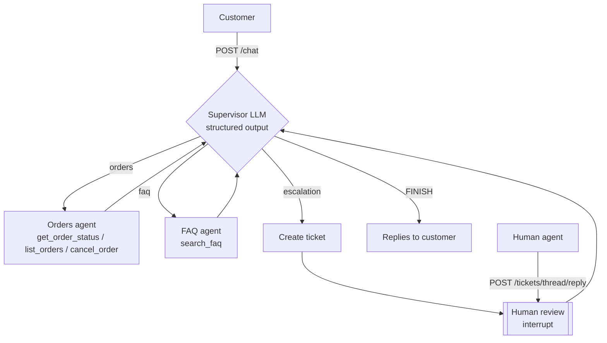

# Multi-Agent Customer Support System

[](https://github.com/sakshi1801/multi-agent-customer-support/actions/workflows/ci.yml)

A supervisor-based multi-agent system built with **LangGraph**, served via **FastAPI**. A supervisor LLM routes each customer message to specialist agents (orders, FAQ, escalation). Escalations pause the graph and wait for a **human agent** (human-in-the-loop), then resume.

**Stack:** Python · LangGraph · LangChain · FastAPI · Pydantic · SQLite · Groq / OpenRouter / Ollama / OpenAI / Azure OpenAI · LangSmith · pytest · Ruff · Docker · GitHub Actions

## Architecture



## What this demonstrates

- **Supervisor pattern**: the router is a LangChain Runnable chain (`prompt | llm.with_structured_output(Route)`) that returns a validated Pydantic `Route`, not free text.
- **Tool calling with server-side identity**: order tools read *who the customer is* from the graph state (`ToolRuntime`), a value set from a signed login token. The model never sees or chooses it, so it cannot be talked into reading another customer's orders.
- **Multi-agent in one turn**: "Status of ORD-1005 and what's your return policy?" visits Orders, then FAQ. Each specialist sees only its own context and a specialist never runs twice for one message.
- **Human-in-the-loop**: `interrupt()` + a SQLite checkpointer pause the conversation (it survives a server restart); a human agent replies by ticket ID and `Command(resume=...)` continues it.
- **Resilience**: provider fallbacks (`.with_fallbacks()`: e.g. Groq, then OpenRouter) and graceful degradation: if routing fails the customer is handed to a human instead of getting a 500.
- **Free to run**: works with Groq or OpenRouter free tiers, or a local Ollama model.
- **Testable**: 67 tests run with a deterministic fake LLM, so CI needs no API key. They include a security suite of prompt-injection and cross-customer attacks.

## Quick start

```bash
python -m venv .venv && source .venv/bin/activate      # Windows: .venv\Scriptsctivate
pip install -r requirements.txt
cp .env.example .env     # add ONE model key (Groq / OpenRouter are free) plus TOKEN_SECRET and AGENT_API_KEY
uvicorn app.main:app --reload
```

Open http://localhost:8000/docs for the interactive API.

### Try it

Demo customers `asha@example.com`, `ravi@example.com` and `meera@example.com` all use the password `demo1234` (fake data only).

```bash
# 0. Log in -> a signed token (identity comes from this token, never from the message)
TOKEN=$(curl -s localhost:8000/auth/login -H 'content-type: application/json'   -d '{"email":"asha@example.com","password":"demo1234"}' | python -c "import sys,json; print(json.load(sys.stdin)['access_token'])")

# 1. Order lookup (own orders only)
curl -s localhost:8000/chat -H "authorization: Bearer $TOKEN" -H 'content-type: application/json'   -d '{"message":"Where is ORD-1001?"}'

# 2. Two specialists in one turn
curl -s localhost:8000/chat -H "authorization: Bearer $TOKEN" -H 'content-type: application/json'   -d '{"message":"Status of ORD-1002, and what is your return policy?"}'

# 3. Policy questions need no login
curl -s localhost:8000/chat -H 'content-type: application/json' -d '{"message":"How long does express shipping take?"}'

# 4. Escalation -> status "waiting_for_human" and a ticket_id
curl -s localhost:8000/chat -H "authorization: Bearer $TOKEN" -H 'content-type: application/json'   -d '{"message":"This is unacceptable, I want a human"}'

# 5. A human agent (X-API-Key = AGENT_API_KEY from .env) lists tickets and replies by ticket ID
curl -s localhost:8000/tickets -H "x-api-key: $AGENT_API_KEY"
curl -s localhost:8000/tickets/1/reply -H "x-api-key: $AGENT_API_KEY" -H 'content-type: application/json'   -d '{"reply":"Sorry about that! We are sending a replacement."}'
```

Demo data: orders `ORD-1001` to `ORD-1005` spread over the three customers.

## Tests, Docker, tracing

```bash
pip install -r requirements-dev.txt         # adds pytest and ruff
pytest -q                                   # 67 tests, no API key needed
ruff check . && ruff format --check .       # lint + formatting (also run in CI)
docker build -t support-agents . && docker run --env-file .env -p 8000:8000 support-agents
```

Set `LANGSMITH_TRACING=true` and `LANGSMITH_API_KEY` in `.env` to see every supervisor decision and tool call in LangSmith.

## Security model

| Threat | Defence |
|---|---|
| Customer reads or cancels another customer's order, including through prompt injection | The customer comes from the signed token and is injected into the tools; every SQL query filters on it; the LLM-visible tool schema has no identity argument. Another customer's order looks identical to a missing one. |
| Forged, expired or tampered tokens | HMAC-signed tokens with expiry, constant-time comparison |
| Continuing someone else's conversation by guessing its thread ID | Threads are bound to their owner (403 otherwise) |
| Anyone calling the human-agent endpoints | `X-API-Key` required; the endpoints stay closed if no key is configured |
| Model outage | Provider fallbacks, then escalation to a human, then a clean 503 without internals |

## Project layout

```
app/config.py   LLM setup: any OpenAI-compatible provider (Groq, OpenRouter, Ollama, OpenAI, Azure) + fallbacks
app/auth.py     password hashing, signed tokens, agent API key
app/db.py       SQLite schema + demo data
app/orders.py   order operations, always scoped to one customer
app/tools.py    agent tools (thin wrappers that read the customer from graph state)
app/graph.py    supervisor + specialists + human-in-the-loop
app/main.py     FastAPI endpoints and schemas
tests/          fake-LLM tests for tools, routing, escalation, security, API
docs/           development plan
```

## Evaluation

> Filled in after Phase 2 (see [docs/DEVELOPMENT_PLAN.md](docs/DEVELOPMENT_PLAN.md)):
> routing accuracy on N hand-written test messages: **__ / __**.

## Known limitations / next steps

See [docs/DEVELOPMENT_PLAN.md](docs/DEVELOPMENT_PLAN.md) for the full roadmap.

- The FAQ search is keyword-based; Phase 3 replaces it with retrieval over embeddings (RAG).
- Login has no rate limiting or password reset; the human-agent key is shared (a real deployment would use SSO).
